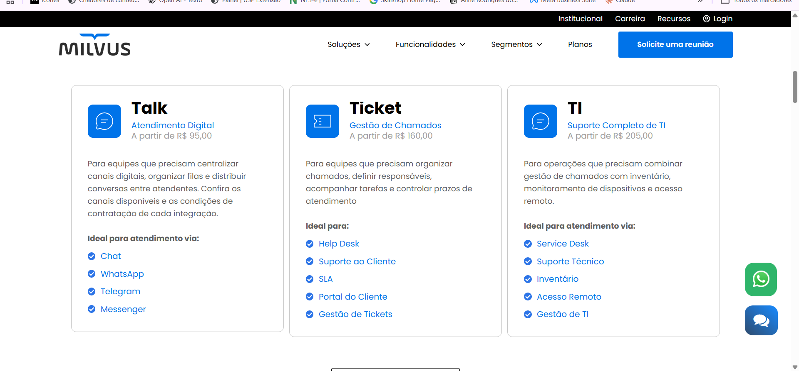
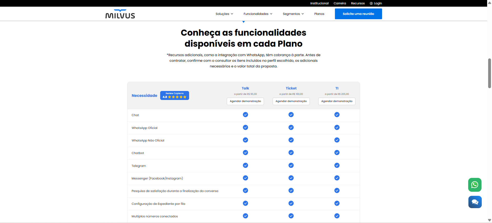
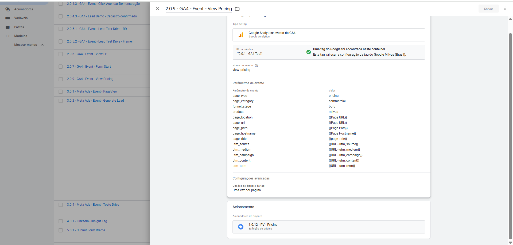

### 🧩 Arquitetura de Marketing, SEO e Tracking | Milvus

**Foco:** arquitetura de páginas estratégicas, SEO, mensuração e jornada comercial para um SaaS B2B.

**Entrega:** diagnóstico, propostas de arquitetura e conteúdo, briefings de páginas e organização da mensuração, com exemplo de configuração de evento no Google Tag Manager.

Atuei na análise e organização da estrutura digital da Milvus, considerando as conexões entre site, páginas de conversão, SEO, mídia paga, analytics, automação de marketing e jornada comercial.

Minha participação incluiu diagnóstico de arquitetura, definição de páginas e seções, direcionamento de SEO e preparação de briefings para redação, design e desenvolvimento, além de recomendações de tracking e qualificação de leads.

#### Frentes trabalhadas

- Diagnóstico da jornada digital e das páginas de conversão.
- Organização de páginas por intenção de busca e etapa da jornada.
- Proposta de páginas institucionais, Central de Confiança, Cases, Preços, Comparativos, Recursos e Help Desk com WhatsApp.
- Definição de seções, hierarquia de conteúdo, CTAs e links internos.
- Recomendações de SEO técnico e conteúdo, incluindo títulos, descrições e estrutura de headings.
- Mapeamento de eventos e parâmetros para contextualizar navegação e conversões.
- Recomendações de integração entre marketing, automação e vendas.

#### Exemplo de aplicação: página de preços

A página de preços foi uma das frentes detalhadas no planejamento. A proposta reuniu recomendações de SEO, mensagem inicial, diferenciação entre os perfis Talk, Ticket e TI, comparação de recursos, perguntas frequentes e CTAs para orientar a avaliação comercial.

As capturas abaixo mostram a página consultada durante a preparação deste case. Elas ilustram o contexto comercial analisado; não constituem um comparativo de antes e depois nem comprovam a implementação integral da proposta.

*Figura 1 — Mensagem inicial e chamada para demonstração na página de preços consultada durante a preparação do case.*

*Figura 2 — Apresentação dos perfis Talk, Ticket e TI, com descrições das necessidades atendidas e exemplos de uso.*

*Figura 3 — Comparação de recursos entre os perfis, como apoio à avaliação comercial. Preços e condições exibidos pertencem à captura e podem mudar.*

#### Exemplo de configuração de tracking

A captura do Google Tag Manager apresenta o evento `view_pricing`, associado a um acionador de exibição da página de preços.

A configuração inclui:

- classificação da página: `page_type = pricing` e `page_category = commercial`;
- classificação de contexto no funil: `funnel_stage = bofu`;
- identificação do produto: `product = milvus`;
- variáveis de URL, caminho, domínio e título da página;
- variáveis para os parâmetros de campanha `utm_source`, `utm_medium`, `utm_campaign`, `utm_content` e `utm_term`.

*Figura 4 — Configuração do evento `view_pricing`, com parâmetros de contexto da página, classificação de funil, variáveis de campanha e acionador associado.*

A imagem documenta a configuração da tag. A confirmação do disparo e do recebimento no GA4 depende de teste específico. A classificação `bofu` descreve o contexto atribuído à página, sem comprovar a intenção ou a qualificação de cada visitante.

#### O que a estrutura buscava permitir analisar

Com implementação e validação das integrações necessárias, a proposta buscava preparar a base para responder:

- Quais canais e campanhas contribuíram para as visitas e conversões?
- Qual página iniciou a jornada e quais páginas foram acessadas antes da conversão?
- Quais CTAs receberam cliques e quais formulários foram enviados?
- Quais soluções e conteúdos despertaram interesse?
- A conversão ocorreu por demonstração, teste, conteúdo, WhatsApp ou outro ponto de contato comercial?
- Como relacionar o comportamento no site à qualificação e ao estágio comercial registrados na automação ou no CRM?

O evento de visualização de preços é uma parte dessa estrutura. As demais perguntas dependem de eventos adicionais, identificação e integração entre fontes, conforme o escopo de cada análise.

#### Cuidados considerados

- Governança de eventos e consistência de nomenclatura.
- Separação entre visualizações, microconversões, conversões principais e eventos comerciais.
- Organização dos parâmetros de campanha e validação de sua disponibilidade ao longo da jornada.
- Validação antes de alterações em tags ou integrações.
- Uso de informações e provas sociais com validação interna.
- Alinhamento entre marketing, vendas e automação.

#### Entregas e limites do case

O trabalho resultou em uma base de planejamento para orientar conteúdo, design, desenvolvimento e mensuração, com arquitetura recomendada, briefings de páginas, pontos de validação e recomendações de SEO e tracking.

As evidências apresentadas reúnem o contexto da página consultada e uma configuração de tracking. Não foram apresentados neste case resultados medidos de aumento de conversão, tráfego orgânico ou qualidade dos leads atribuíveis às recomendações.

➡️ [Ver case completo de arquitetura de páginas](https://github.com/alinerodriguesrosario-lgtm/marketing-tech-portfolio-/tree/Main/milvus-site-architecture-seo-case)

