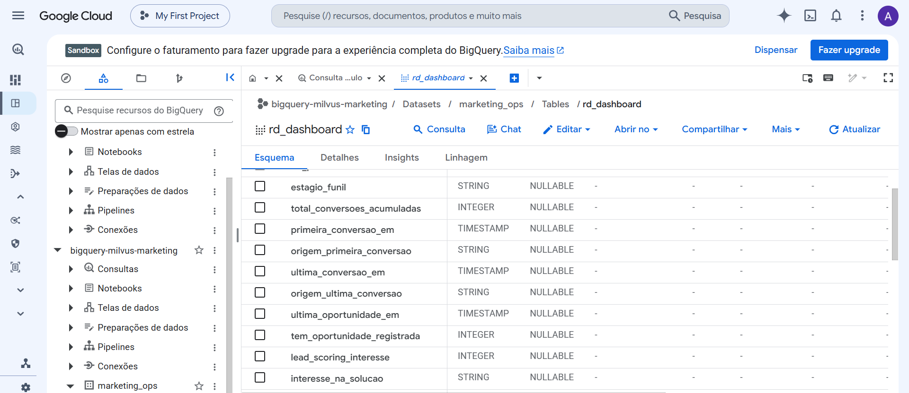
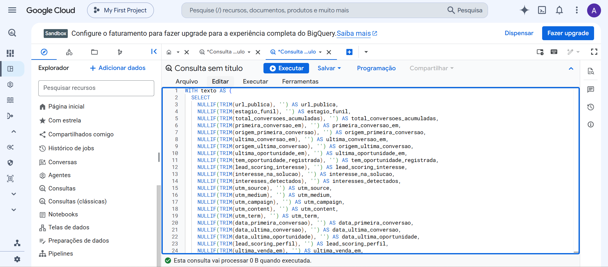
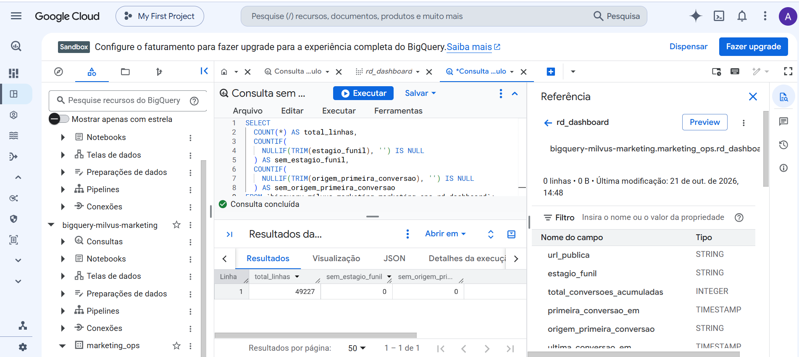
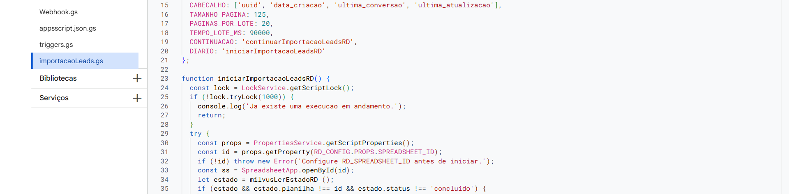

### Preparação e validação de dados de marketing com SQL e Apps Script

Case baseado em atividades reais na Milvus, com foco na organização de dados do RD Station para apoiar análises de marketing.

**Foco:** preparação de bases, tratamento de dados e rotinas de integração.

**Entrega:** consultas SQL, módulos de Apps Script e documentação operacional para conectar dados de marketing a uma base de análise.

**Status:** desenvolvimento incremental, com etapas validadas e pendências de integração e cobertura ainda em acompanhamento.

## Contexto e desafio

O projeto envolveu reunir informações de contatos, conversões e qualificação do RD Station, verificar a consistência das cargas e preparar os campos para consulta e visualização.

Além de disponibilizar os dados, era necessário entender o significado de cada campo: uma data poderia representar a criação do contato, uma conversão ou a consulta à API; um registro comercial poderia representar um evento histórico ou uma oportunidade atual.

As perguntas que orientaram o trabalho incluíram:

- O total de linhas corresponde ao total de contatos únicos?
- Há campos vazios ou valores que não foram convertidos corretamente?
- Qual evento cada data representa?
- O contato possui uma oportunidade atual ou apenas um registro histórico?
- Quais informações precisam de revisão antes do encaminhamento comercial?

## Minha participação

Atuei na definição das necessidades de marketing, organização dos campos, acompanhamento das integrações e validação das informações apresentadas nas bases e no painel.

Desenvolvi minha prática em SQL e Apps Script com apoio de IA na escrita e revisão de código. Minha participação incluiu traduzir perguntas de negócio em requisitos, aplicar e testar ajustes, investigar inconsistências e documentar o funcionamento das rotinas.

## Fluxo dos dados

O fluxo documentado para os dados de contatos foi:

**RD Station → Apps Script → Planilhas Google → BigQuery → Looker Studio**

A importação inicial de contatos e a atualização da base de qualificação foram documentadas como rotinas distintas, com campos e regras próprias. A captura de eventos comerciais também foi tratada separadamente da situação atual dos contatos.

## Preparação e tratamento no BigQuery

Foram estruturadas consultas para leitura da planilha por tabela externa, conferência de volumes, contagem de identificadores distintos, verificação de preenchimento, criação de uma visão com campos tipados e auditoria de valores não convertidos.

O esquema da visão analítica apresenta campos de texto, números inteiros e datas com horário. Essa estrutura permite trabalhar com os tipos adequados para filtros, contagens e análises temporais.

*Figura 1 — Estrutura da visão analítica no BigQuery, com tipos definidos para campos de funil, conversões e informações comerciais.*

No trecho de SQL apresentado, `TRIM` remove espaços nas extremidades e `NULLIF` transforma textos vazios em `NULL`. Esse tratamento permite identificar a ausência de informação nesses campos sem representá-la como um texto vazio.

*Figura 2 — Trecho da definição da visão analítica, com limpeza de campos de texto e tratamento de valores vazios. A imagem mostra a etapa de limpeza; os tipos finais aparecem no esquema da Figura 1.*

## Evidência de validação da base

Na consulta registrada na captura, a visão retornou:

| Verificação | Resultado |
| --- | ---: |
| Total de linhas | 49.227 |
| Linhas sem estágio do funil | 0 |
| Linhas sem origem da primeira conversão | 0 |

A verificação considerou campos nulos e textos vazios após a remoção de espaços nas extremidades.

*Figura 3 — Resultado da consulta de volume e preenchimento na visão analítica, no momento da conferência.*

Esses resultados demonstram o preenchimento dos dois campos avaliados nessa consulta. Não comprovam, por si só, a validade dos valores, a ausência de duplicidades ou a conclusão da carga. As **49.227 linhas não foram apresentadas como 49.227 contatos únicos**, pois essa consulta não contou UUIDs distintos.

## Rotina de importação em Apps Script

Foram configurados módulos para consultar contatos por paginação, processar lotes, registrar progresso e apoiar a retomada entre execuções.

O trecho apresentado contém os seguintes parâmetros:

| Parâmetro | Configuração |
| --- | ---: |
| Tamanho da página | 125 registros |
| Páginas por lote | 20 |
| Limite de tempo configurado para o lote | 90.000 ms (90 segundos) |

O código também mostra o uso de `LockService` para impedir que uma nova execução prossiga enquanto outra mantém o bloqueio, a leitura do ID da planilha nas propriedades do script e a consulta ao estado salvo da carga.

*Figura 4 — Rotina de importação com parâmetros de paginação e processamento em lotes, controle de execução simultânea e leitura do estado da carga.*

Os valores apresentados são configurações do código. Eles não representam volume efetivamente importado, duração medida ou garantia de conclusão em uma execução. A conclusão de um lote precisa ser diferenciada da conclusão de toda a carga.

## Investigação de inconsistências

Durante os testes do projeto, uma importação apresentou diferença entre a quantidade de linhas lidas e o total de UUIDs únicos. A rotina bloqueou a publicação da carga inconsistente, e a investigação levou à revisão da ordenação da consulta e à manutenção das verificações antes da publicação.

A repetição de UUIDs na leitura não foi tratada como prova de cadastros duplicados no RD Station. Alterações na base durante a paginação foram consideradas uma hipótese a investigar.

Esse episódio faz parte do histórico de desenvolvimento e é distinto da consulta de preenchimento exibida na Figura 3.

## Documentação e aprendizados

Os materiais foram organizados por finalidade, origem e versão, com descrição das entradas e saídas, funções de controle, dependências de validação no ambiente real e exemplos anteriores de aprendizado ou experimentação.

Os principais aprendizados foram:

- Traduzir perguntas de marketing em campos, consultas e critérios de conferência.
- Diferenciar uma execução sem erro de uma atualização completa da base.
- Considerar tipos, valores ausentes e significado dos dados na interpretação dos indicadores.
- Documentar as rotinas para facilitar manutenção e revisão.
- Usar SQL e Apps Script para investigar dados e apoiar a operação de marketing.

## Limites e próximos passos

O trabalho permanece em evolução. Não foram medidos ganhos de receita, redução de custos ou economia de horas atribuíveis às rotinas.

As próximas etapas incluem:

- Conferir os objetos existentes no BigQuery e as versões instaladas dos scripts.
- Validar a atualização completa e a inclusão de novos contatos.
- Concluir os testes de cobertura da captura de detalhes.
- Medir duração, falhas e conclusão das cargas ao longo do tempo.
- Evoluir as análises de qualidade dos leads e encaminhamento comercial.

## Conteúdo desta pasta

Esta pasta reúne o texto do case e as quatro capturas de evidência. Os módulos completos de Apps Script e os arquivos SQL não estão incluídos neste pacote.

As capturas não exibem registros individuais de contatos ou valores de credenciais. As imagens do BigQuery ainda mostram nomes de projeto e objetos técnicos; sua divulgação deve seguir a autorização aplicável aos materiais da empresa.
