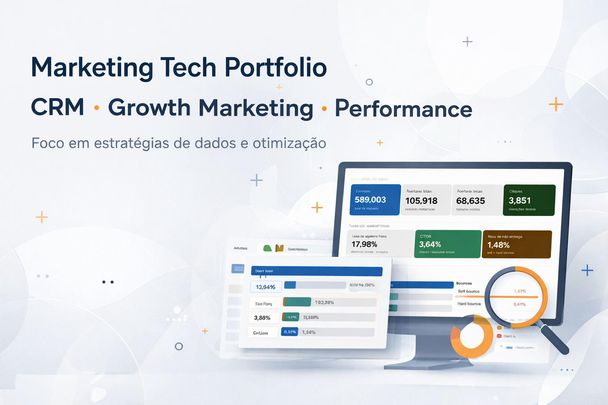

# 👩‍💻 Aline Rosário

Projetos aplicados em **SEO técnico, arquitetura de informação, mídia paga, dados e automação de marketing**, com foco em crescimento estruturado, mensurável e escalável.

---

## ⚡ Competências & Ferramentas

SEO Técnico • Arquitetura de Informação • Marketing Ops • Estratégia Digital • Google Search Console • GA4 • Google Tag Manager • Google Ads • Meta Ads • Looker Studio • BigQuery • SQL • Google Apps Script • Google Sheets • RD Station • CRM • Tracking • GitHub

---

## 🚀 Projetos

### 🗃️ BigQuery, SQL e Apps Script para Marketing Ops | Milvus

**Foco:** preparação de bases, tratamento de dados e rotinas de integração para apoiar análises de marketing.

**Entrega:** consultas SQL, módulos de Apps Script e documentação operacional para organizar dados de contatos, conversões e qualificação.

**Status:** projeto em evolução, com etapas validadas e pendências documentadas.

➡️ [Ver projeto completo](https://github.com/alinerodriguesrosario-lgtm/marketing-tech-portfolio-/tree/Main/BigQuery%2C%20SQL%20e%20Apps%20Script%20para%20Marketing%20Ops%20%7C%20Milvus)

### 📊 Auditoria de Tracking | Milvus

**Foco:** revisão da mensuração entre GTM, GA4, formulários, RD Station e CRM.

➡️ [Ver projeto completo](https://github.com/alinerodriguesrosario-lgtm/marketing-tech-portfolio-/tree/Main/case-portfolio-auditoria-correcao-tracking-gtm-milvus)

---

### 🧭 Arquitetura de Páginas e SEO Técnico | Milvus

**Foco:** reestruturação de páginas institucionais, comerciais, comparativas, de segurança e recursos para um site B2B SaaS.

**Entrega:** proposta de arquitetura orientada à jornada do usuário, SEO técnico, confiança, prova social e apoio à conversão.

Páginas idealizadas:

- Sobre a Milvus
- Central de Confiança
- Help Desk com WhatsApp
- Cases
- Preços
- Comparativos
- Recursos

➡️ [Ver projeto completo](https://github.com/alinerodriguesrosario-lgtm/marketing-tech-portfolio-/tree/Main/milvus-site-architecture-seo-case)

---

### 📊 Análise de Performance de CRM | FEMME LABORATÓRIO DA MULHER

**Foco:** análise estratégica de campanhas de CRM e identificação de oportunidades de otimização.

**Entrega:** leitura de dados para apoiar decisões de relacionamento, ativação e melhoria de performance.

➡️ [Ver projeto completo](https://github.com/alinerodriguesrosario-lgtm/marketing-tech-portfolio-/tree/Main/femme-crm-performance)

---

### 🔍 SEO Técnico | Grupo Cecil

**Foco:** indexação, performance e rastreabilidade.

**Resultado:** melhorias técnicas documentadas e estruturação da base para crescimento orgânico.

➡️ [Ver projeto completo](https://github.com/alinerodriguesrosario-lgtm/marketing-tech-portfolio-/tree/Main/grupo-cecil-seo)

---

### 🚀 Performance Integrada | São Lucas

**Foco:** leitura cruzada entre Meta Ads e Google Ads.

**Entrega:** análise dos canais e recomendações para alocação de investimento e apoio à conversão.

➡️ [Ver projeto completo](https://github.com/alinerodriguesrosario-lgtm/marketing-tech-portfolio-/tree/Main/sao-lucas-estrategia)

---

### 📈 Google Ads | Conversão

**Foco:** captura de demanda e análise da eficiência de aquisição.

**Entrega:** avaliação de investimento, tráfego, conversões e oportunidades de otimização.

➡️ [Ver projeto completo](https://github.com/alinerodriguesrosario-lgtm/marketing-tech-portfolio-/tree/Main/google-ads-performance)

---

### 📊 Meta Ads | Alcance e Aquisição

**Foco:** segmentação, distribuição e construção de audiência.

**Entrega:** análise de alcance, custos, criativos e oportunidades de melhoria.

➡️ [Ver projeto completo](https://github.com/alinerodriguesrosario-lgtm/marketing-tech-portfolio-/tree/Main/meta-ads-aquisicao)

---

## 🧠 Abordagem

Estruturo o trabalho de marketing com base em:

- Jornada do usuário
- Dados confiáveis e rastreáveis
- Arquitetura clara de páginas e canais
- Integração entre SEO, mídia paga, conteúdo e CRM
- Automação e documentação de processos
- Validação e otimização contínua

---

## 👩‍💻 Sobre

Profissional de **Comunicação, Branding e Marketing Digital**, com atuação em:

- SEO técnico e arquitetura de informação
- Performance em Google Ads e Meta Ads
- CRM, segmentação e automação de marketing
- Tracking e estruturação de dados
- Análise de métricas e construção de dashboards
- Aplicação de SQL, BigQuery e Apps Script em projetos de Marketing Ops

Conecto comunicação, dados e tecnologia para estruturar operações de marketing mais consistentes, mensuráveis e escaláveis.

🎓 Especialista em Mídia, Informação e Cultura — ECA/USP

---

## 📬 Contato

- 💼 [LinkedIn](https://www.linkedin.com/in/alinerosario/)
- 🎨 [Behance](https://www.behance.net/alinerosario)
- 📧 [aline.rodrigues.rosario@gmail.com](mailto:aline.rodrigues.rosario@gmail.com)

