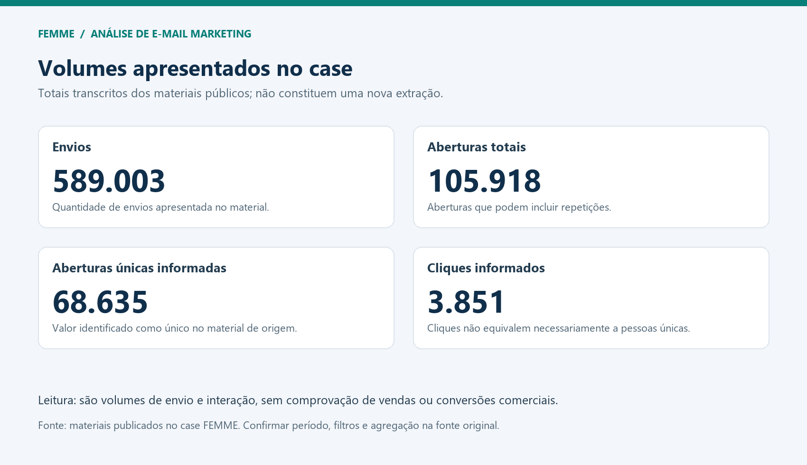
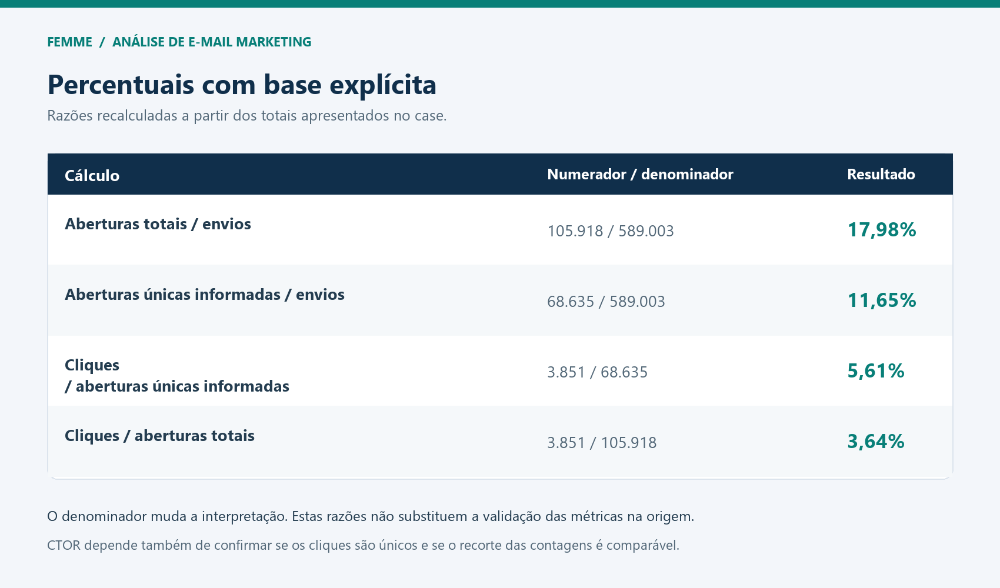

# 📊 Análise de campanhas de CRM | FEMME Laboratório da Mulher

**Foco:** análise de e-mail marketing, consistência de indicadores e identificação de oportunidades de melhoria na comunicação.

**Entrega:** leitura dos volumes de envio e interação, revisão das bases de cálculo e recomendações de investigação e testes.

## Contexto e objetivo

Este case apresenta uma análise dos indicadores disponíveis nos materiais de campanhas de CRM. O objetivo é organizar a leitura dos dados e transformar observações em perguntas e recomendações para a operação de marketing.

A revisão apresentada aqui utiliza os totais divulgados no case. Não se trata de uma nova exportação da ferramenta de e-mail nem de um teste de otimização concluído.

## Volumes analisados

| Indicador informado | Quantidade |
| --- | ---: |
| Envios | 589.003 |
| Aberturas totais | 105.918 |
| Aberturas únicas informadas | 68.635 |
| Cliques informados | 3.851 |

*Figura 1 — Volumes transcritos dos materiais do case. Aberturas totais podem incluir repetições; cliques não equivalem necessariamente a pessoas distintas.*

## Revisão das bases de cálculo

A conferência identificou que os percentuais de 17,98% e 3,64% apresentados nos materiais são compatíveis com o uso de **aberturas totais**, embora alguns rótulos mencionassem aberturas únicas.

Para explicitar a diferença, foram recalculadas as seguintes razões:

| Cálculo | Numerador ÷ denominador | Resultado |
| --- | --- | ---: |
| Aberturas totais por envio | 105.918 ÷ 589.003 | 17,98% |
| Aberturas únicas informadas por envio | 68.635 ÷ 589.003 | 11,65% |
| Cliques por abertura única informada | 3.851 ÷ 68.635 | 5,61% |
| Cliques por abertura total | 3.851 ÷ 105.918 | 3,64% |

*Figura 2 — Razões calculadas a partir dos totais apresentados, com arredondamento para duas casas decimais.*

Essas razões tornam os cálculos verificáveis, mas a definição operacional das taxas exige confirmar o período, os filtros e a agregação das contagens na fonte original. A razão de 5,61% não é apresentada como CTOR validado: ainda é necessário verificar se os cliques são únicos e se as contagens são comparáveis no mesmo recorte. Dividir totais de escopos diferentes não produz uma taxa consolidada válida.

## Leitura analítica

Os materiais apresentam interações em etapas diferentes: envio, abertura e clique. Essa leitura ajuda a orientar uma investigação sobre conteúdo, segmentação e chamadas para ação.

Os totais, isoladamente, não estabelecem um padrão de desempenho bom ou ruim. Também não permitem concluir que os usuários ficaram insatisfeitos, que o assunto foi eficaz ou que um CTA causou uma queda de engajamento.

As perguntas prioritárias são:

- Quais campanhas e períodos estão incluídos no consolidado?
- As aberturas e os cliques foram contabilizados como eventos ou interações únicas?
- Há campanhas com maior ou menor proporção de cliques, considerando objetivo e público?
- Existem diferenças por segmento, tipo de conteúdo, dispositivo ou CTA?
- Os cliques levam a ações relevantes na página de destino ou a conversões confirmadas?

## Recomendações

- Conferir as definições dos indicadores e padronizar os denominadores.
- Separar a análise por campanha, objetivo, período e segmento.
- Investigar os conteúdos e CTAs das campanhas com menor resposta, considerando o contexto.
- Formular testes A/B com hipótese, métrica principal e critério de avaliação definidos.
- Relacionar cliques ao comportamento na página de destino e às conversões, quando houver dados disponíveis.
- Avaliar a qualidade da base com contagens de entregas, erros e descadastros na fonte original.

## O que este case demonstra

- Leitura crítica de indicadores de CRM.
- Conferência de cálculos e identificação de divergências de nomenclatura.
- Separação entre dados observados, hipóteses e recomendações.
- Organização de análises para apoiar decisões de comunicação e testes.

## Limites e próximos passos

O período e os filtros da exportação devem ser confirmados na fonte original. A conciliação por campanha e a definição de cliques únicos permanecem como etapas de validação.

Não são apresentados ganhos medidos de receita, conversão ou engajamento atribuíveis às recomendações. A análise orienta investigação e planejamento de testes.

## Arquivos

- `images/01-volumes-crm.png`: visualização dos volumes informados.
- `images/02-percentuais-crm.png`: cálculos com bases explícitas.
- [Planilha de cálculos em CSV](./metricas-recalculadas.csv).

As figuras desta versão foram refeitas a partir dos totais dos materiais públicos do case para manter os rótulos alinhados aos cálculos. Não são capturas de uma nova execução das campanhas.

[Voltar ao portfólio](https://github.com/alinerodriguesrosario-lgtm/marketing-tech-portfolio-/tree/Main)
