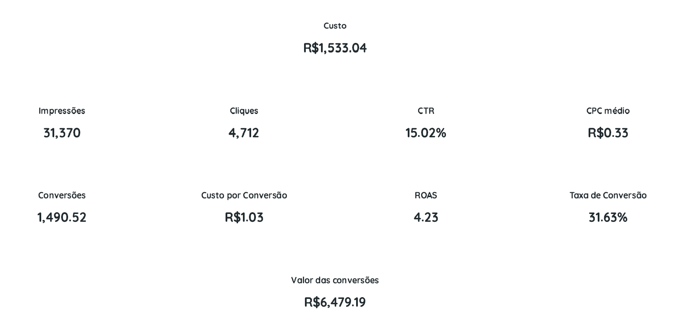
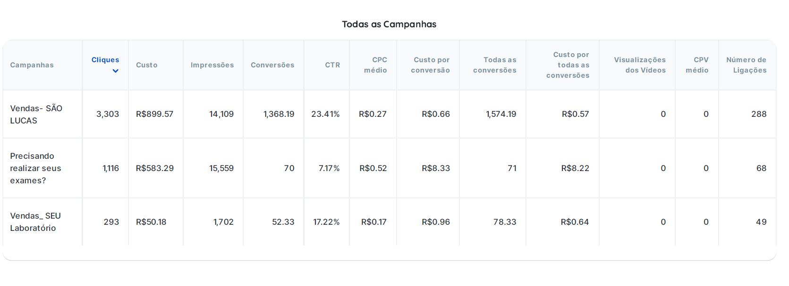
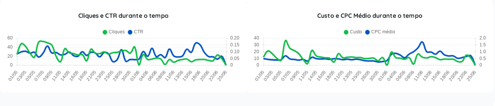
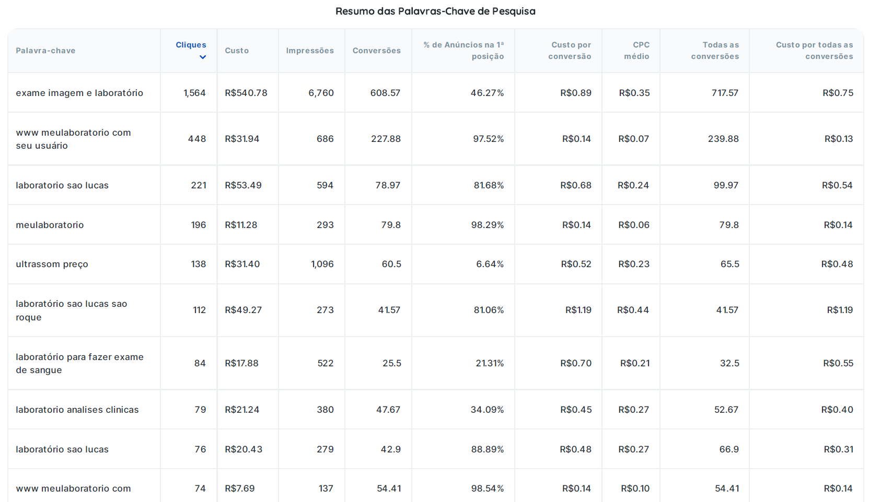
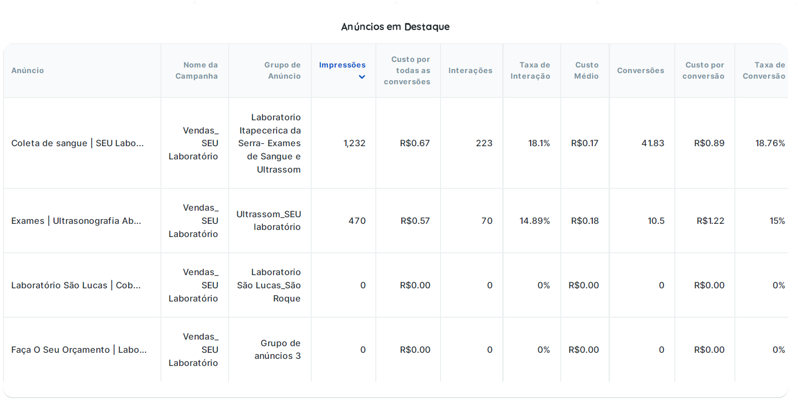
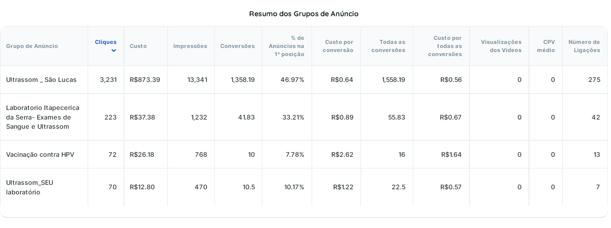
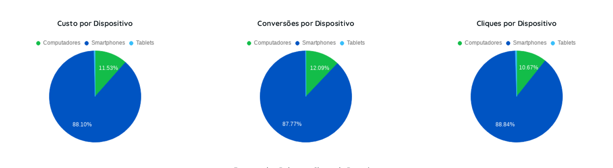

# 🔎 Google Ads — Análise de aquisição e conversões | São Lucas

**Foco:** leitura de campanhas de pesquisa para serviços laboratoriais, com análise de tráfego, custos e conversões registradas.

**Entrega:** diagnóstico dos indicadores disponíveis e recomendações para investigar campanhas, palavras-chave e experiência de conversão.

## Contexto e objetivo

O case apresenta a análise dos relatórios de Google Ads disponibilizados no projeto. O objetivo comercial era apoiar a captação de demanda por serviços laboratoriais; o escopo demonstrado aqui é a leitura dos resultados registrados e a identificação de oportunidades de melhoria.

As capturas representam um recorte histórico. O intervalo completo, o ano e os filtros devem ser recuperados na fonte antes de comparações com outros períodos.

## Indicadores apresentados

| Indicador | Valor exibido no relatório |
| --- | ---: |
| Investimento em mídia | R$ 1.533,04 |
| Impressões | 31.370 |
| Cliques | 4.712 |
| CTR | 15,02% |
| CPC médio | R$ 0,33 |
| Conversões registradas | 1.490,52 |
| Taxa de conversão | 31,63% |
| Custo por conversão registrada | R$ 1,03 |
| Valor das conversões | R$ 6.479,19 |
| Relação valor das conversões / custo | 4,23 |

*Figura 1 — Consolidado do relatório. O quadro original identifica R$ 6.479,19 como “Valor das conversões” e apresenta 1.490,52 conversões, com casas decimais.*

## Como interpretar as conversões

O material apresenta uma contagem de **1.490,52**, que deve ser preservada como indicador do relatório. O Google Ads pode distribuir crédito fracionado entre interações, conforme a atribuição utilizada. A captura, isoladamente, não identifica o modelo ativo nem as ações incluídas no consolidado.

Antes de interpretar essas conversões como contatos, agendamentos ou exames realizados, é necessário confirmar quais ações foram configuradas como conversão, suas regras de contagem e sua conciliação com os registros comerciais.

Por isso, o custo de R$ 1,03 é descrito como **custo por conversão registrada**, sem ser apresentado como custo de aquisição de um cliente.

## Valor das conversões e retorno

O consolidado informa **Valor das conversões**, que pode depender de valores fixos ou dinâmicos definidos na mensuração. A natureza desse valor não foi comprovada como receita recebida nos materiais apresentados.

A divisão de R$ 6.479,19 por R$ 1.533,04 resulta em aproximadamente **4,23**, valor rotulado como ROAS no quadro original. Neste case, ele é apresentado como relação entre valor atribuído às conversões e custo de mídia. A interpretação como retorno sobre receita depende de validar a origem dos valores e sua correspondência com vendas confirmadas.

Os dados disponíveis também não demonstram margem, lucro ou manutenção do desempenho após aumento de investimento.

## Leitura das campanhas

A análise considerou o consolidado e os recortes por campanha, grupo de anúncios, palavra-chave, anúncio e dispositivo.

O CTR de 15,02% descreve a proporção de cliques em relação às impressões do consolidado. A avaliação de sua adequação exige considerar o mix de marca e termos genéricos, correspondências, posições, públicos e objetivo de cada campanha.

Na tabela de campanhas, “Vendas — SÃO LUCAS” apresenta CTR de 23,41% e custo por conversão registrada de R$ 0,66. Esses indicadores ajudam a selecionar recortes para investigação, mas o nome da campanha e os resultados de mídia não confirmam vendas efetivamente realizadas.

*Figura 2 — Comparação dos indicadores por campanha, mantendo a distinção entre conversões registradas e resultados comerciais confirmados.*

## Recomendações de análise e otimização

- Confirmar as ações de conversão, regras de contagem, atribuição e valores configurados.
- Relacionar os registros de mídia a contatos, agendamentos e vendas, quando houver dados comerciais disponíveis.
- Separar campanhas e consultas de marca, termos genéricos e serviços específicos.
- Investigar termos de pesquisa, correspondências e oportunidades de negativação.
- Avaliar anúncios e páginas de destino em conjunto, com hipóteses de teste explícitas.
- Comparar dispositivos e horários utilizando a mesma definição de conversão e qualidade do contato.
- Avaliar mudanças de orçamento após validar qualidade, capacidade de atendimento e resultados comerciais.

## Evidências complementares

### Evolução dos indicadores

*Figura 3 — Evolução dos indicadores de tráfego e custo no recorte apresentado.*

### Palavras-chave

*Figura 4 — Indicadores por palavra-chave como apoio à investigação de intenção, marca e serviços.*

### Anúncios

*Figura 5 — Recorte dos anúncios disponíveis no relatório.*

### Grupos de anúncios

*Figura 6 — Organização dos resultados por grupo de anúncios.*

### Dispositivos

*Figura 7 — Recorte por dispositivo para orientar a análise da experiência de navegação e conversão.*

## O que o case demonstra

- Leitura de indicadores de aquisição e mensuração.
- Comparação de recortes para orientar investigação e testes.
- Distinção entre conversão registrada, valor atribuído e resultado comercial.
- Organização de recomendações baseadas no contexto dos dados.

## Limites e próximos passos

O próximo passo é validar período e filtros, definições das conversões e origem dos valores, além de conciliar os resultados com a operação comercial. O material não comprova, por si só, receita recebida, lucro ou possibilidade de escalar mantendo rentabilidade.

As recomendações são propostas de investigação e otimização; seus efeitos posteriores não foram medidos neste case.

## Referências de mensuração

- [Google Ads — interpretação dos dados de conversão](https://support.google.com/google-ads/answer/6270625?hl=pt-BR).
- [Google Ads — valores de conversão](https://support.google.com/google-ads/answer/13064207?hl=pt-BR).
- [Google Ads — modelos de atribuição](https://support.google.com/google-ads/answer/6259715?hl=pt-BR).
- [Esclarecimento da equipe Google Ads API sobre crédito fracionado](https://groups.google.com/g/adwords-api/c/thH0hGLqsY0/m/UC5VzzqeAwAJ).

[Ver análise conjunta de Meta Ads e Google Ads](../sao-lucas-estrategia/README.md) · [Voltar ao portfólio](../README.md)
