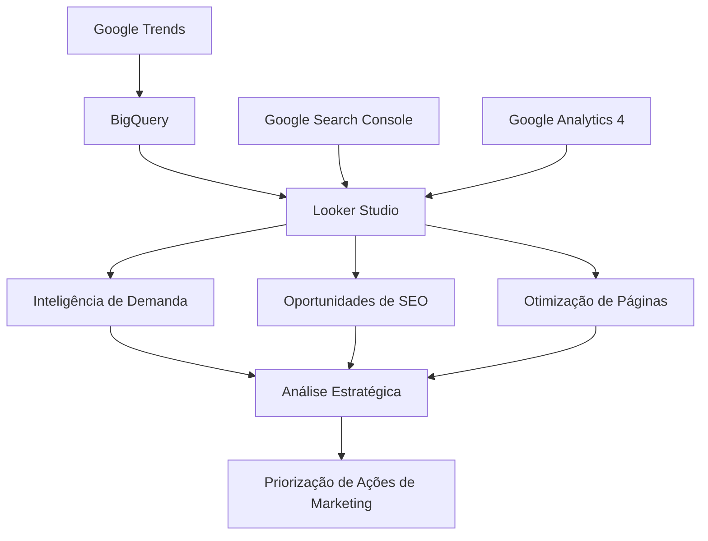
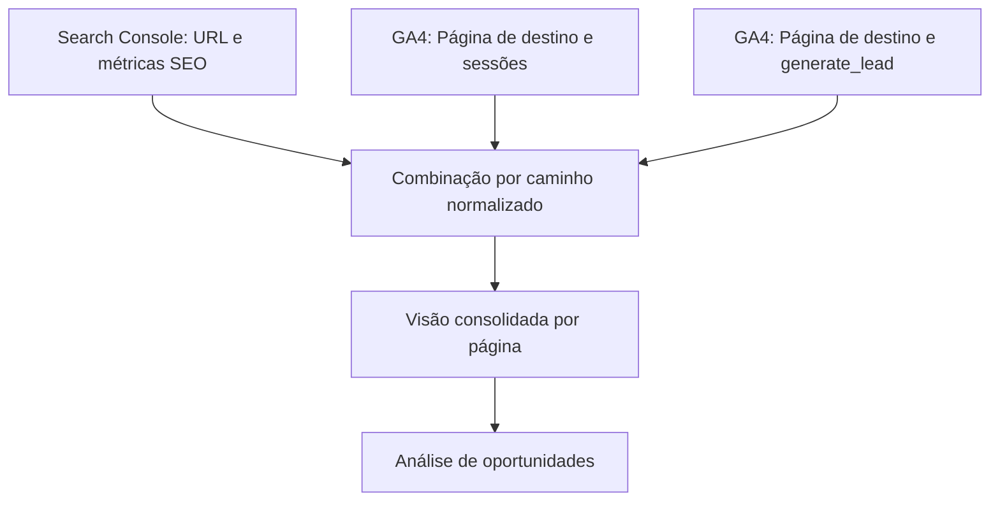

# Marketing Intelligence & SEO Opportunity Engine

### Inteligência de Demanda, SEO Analytics e Growth Ops para SaaS B2B


---

## Sobre o projeto

Projeto de Marketing Intelligence desenvolvido para demonstrar a integração entre dados de demanda de mercado, desempenho orgânico e comportamento de usuários em um contexto B2B SaaS.

A solução utiliza Google Trends, BigQuery, Google Search Console, Google Analytics 4 e Looker Studio para estruturar análises que apoiam decisões estratégicas de SEO, aquisição orgânica e geração de leads.

O objetivo é transformar dados dispersos em informações acionáveis para o Marketing.

> **Nota:** este repositório apresenta uma versão demonstrativa da metodologia utilizada em um projeto profissional. Os exemplos públicos utilizam dados sintéticos e não divulgam informações corporativas confidenciais.

---

## O desafio

A análise de Marketing frequentemente acontece em ferramentas isoladas:

- Google Trends identifica tendências de pesquisa.
- Search Console apresenta visibilidade orgânica.
- GA4 monitora comportamento e conversões.
- Plataformas de CRM armazenam informações dos leads.

Essa fragmentação dificulta identificar quais tendências do mercado representam oportunidades relevantes para aquisição de clientes.

### Problema central

Como conectar interesse de mercado, desempenho orgânico e geração de leads para orientar estratégias de crescimento em um negócio SaaS B2B?

---

## Objetivos

- Monitorar tendências de busca relacionadas às soluções da empresa.
- Identificar oportunidades de SEO por palavra-chave.
- Categorizar consultas por intenção e área estratégica.
- Analisar impressões, cliques, CTR e posição média.
- Identificar páginas com potencial de otimização.
- Relacionar dados do Search Console com o GA4.
- Monitorar sessões orgânicas e eventos de geração de leads.
- Criar uma estrutura analítica de apoio à tomada de decisão.

---

## Tecnologias utilizadas

| Tecnologia | Aplicação |
|---|---|
| Google Trends | Monitoramento de interesse de pesquisa |
| Google BigQuery | Armazenamento e consulta dos dados de tendências |
| Google Search Console | Análise do desempenho orgânico |
| Google Analytics 4 | Sessões, usuários e eventos de conversão |
| Looker Studio | Dashboards, filtros e combinação de dados |
| SQL | Estruturação, consulta e transformação de dados |
| RegExp | Classificação e padronização de informações |

---

## Arquitetura da solução



### Fluxo de dados

**Google Trends → BigQuery → Looker Studio**

Os dados de tendências são exportados, estruturados e consultados no BigQuery.

**Search Console + GA4 → Looker Studio**

As fontes são conectadas ao Looker Studio e combinadas por caminhos de páginas normalizados.

Essa arquitetura permite analisar diferentes aspectos da aquisição orgânica em uma visão integrada.

---

## Módulo 1: Inteligência de Demanda

O primeiro módulo utiliza dados do Google Trends para acompanhar o interesse por termos estratégicos.

### Indicadores

- Interesse médio de busca
- Pico de interesse
- Evolução temporal
- Períodos monitorados
- Comparação de temas

### Categorias monitoradas

| Categoria | Exemplos |
|---|---|
| Service Desk / ITSM | service desk, help desk, sistema de chamados |
| Inteligência Artificial | agentes de IA, chatbot, IA no suporte |
| Omnichannel | atendimento omnichannel, WhatsApp Business |
| Gestão de TI | ITIL, SLA, gestão de ativos |
| Automação | automação de chamados, automação de processos |

O Google Trends apresenta índices relativos de interesse, de 0 a 100, e não volumes absolutos de pesquisas.

Comparações entre termos exigem cuidado com período, região e normalização dos dados.

---

## Módulo 2: Oportunidades de SEO

Integração com o Google Search Console para análise de palavras-chave e visibilidade orgânica.

### Indicadores

- Impressões
- Cliques
- CTR orgânico
- Posição média
- Categoria estratégica

### Classificação automática

As palavras-chave são classificadas usando expressões regulares e regras condicionais.

Categorias utilizadas:

- Marca
- Concorrentes
- Service Desk / ITSM
- Gestão de TI
- Inteligência Artificial
- Omnichannel
- Automação
- Outros

Essa estrutura permite separar buscas de marca, pesquisas sobre concorrentes e consultas relacionadas às soluções.

### Exemplo de classificação

```sql
CASE
  WHEN REGEXP_CONTAINS(
    LOWER(Query),
    'service desk|help desk|itsm'
  )
  THEN 'Service Desk / ITSM'

  WHEN REGEXP_CONTAINS(
    LOWER(Query),
    'chatbot|inteligência artificial|agentes de ia'
  )
  THEN 'Inteligência Artificial'

  WHEN REGEXP_CONTAINS(
    LOWER(Query),
    'omnichannel|multicanal'
  )
  THEN 'Omnichannel'

  ELSE 'Outros'
END
```

A expressão acima representa um exemplo simplificado da metodologia de classificação usada no Looker Studio.

---

## Módulo 3: Otimização de Páginas

O terceiro módulo relaciona URLs e consultas do Search Console para identificar oportunidades de melhoria.

### Critérios exploratórios

| Indicador | Critério |
|---|---|
| Impressões | A partir de 100 |
| CTR orgânico | Inferior a 2% |
| Intenção de busca | Avaliação por consulta |
| Relevância comercial | Avaliação estratégica |

Esses critérios ajudam a selecionar páginas candidatas à análise, mas não determinam automaticamente quais devem ser otimizadas.

### Possíveis ações

- Revisão de títulos SEO
- Otimização de meta descriptions
- Atualização de conteúdos
- Melhoria de links internos
- Adequação à intenção de busca
- Revisão de CTAs

---

## Módulo 4: Integração SEO + GA4

A solução utiliza a combinação de dados do Search Console e do Google Analytics 4 para relacionar visibilidade orgânica e comportamento dos visitantes.

### Métricas analisadas

| Search Console | Google Analytics 4 |
|---|---|
| Impressões | Sessões orgânicas |
| Cliques | Usuários ativos |
| CTR | Eventos de geração de leads |
| URL | Página de destino |

### Normalização de URLs

O Search Console utiliza URLs completas, enquanto o GA4 pode trabalhar com caminhos de páginas.

Para possibilitar a combinação, foi criado um campo calculado:

```sql
REGEXP_REPLACE(
  Landing Page,
  '^https?://[^/]+',
  ''
)
```

Exemplo:

**Entrada**

`https://exemplo.com.br/solucoes/service-desk`

**Saída**

`/solucoes/service-desk`

O caminho normalizado pode ser relacionado à dimensão Página de destino do GA4, após validação de diferenças de formatação.

### Estrutura da combinação



### Governança das métricas

A combinação exige alguns cuidados:

- Validar a granularidade das fontes.
- Evitar duplicação de sessões e conversões.
- Padronizar URLs.
- Utilizar o mesmo período.
- Validar filtros de tráfego orgânico.
- Diferenciar eventos registrados de leads efetivamente confirmados.

## Cálculo de CTR

O CTR deve ser calculado a partir da relação entre cliques e impressões.

```sql
SAFE_DIVIDE(
  SUM(cliques),
  SUM(impressoes)
)

O resultado deve ser apresentado em formato percentual.

Não é correto somar taxas de CTR de diferentes páginas ou consultas.


## Módulo 5: Priorização Estratégica de SEO

A etapa de priorização combina indicadores quantitativos e critérios de negócio.

### Dimensões consideradas

1. Potencial de visibilidade orgânica
2. Desempenho atual de cliques
3. CTR
4. Sessões orgânicas
5. Eventos de geração de leads
6. Relevância comercial
7. Intenção de busca

### Modelo conceitual

| Prioridade | Característica |
|---|---|
| Alta | Potencial de melhoria e elevada relevância comercial |
| Média | Oportunidade identificada que exige investigação |
| Baixa | Menor potencial ou baixa aderência estratégica |

A pontuação final depende de validação das métricas, da intenção das buscas e dos objetivos comerciais.


## Principais decisões técnicas

### 1. Separação de categorias

Buscas pela marca e por concorrentes foram separadas das buscas genéricas por soluções.

### 2. Padronização de URLs

Foi criada uma chave de correspondência entre Search Console e GA4.

### 3. Tratamento de métricas

O CTR passou a ser calculado a partir de cliques e impressões, evitando agregações incorretas.

### 4. Segmentação orgânica

Os dados do GA4 foram filtrados por origem/mídia da sessão para analisar o tráfego `google / organic`.

### 5. Conversões

O evento `generate_lead` foi utilizado como indicador de geração de leads, sujeito à validação com o sistema de CRM.

## Resultados do projeto

### Entregas realizadas

- Estruturação de dados do Google Trends no BigQuery.
- Construção do módulo de Inteligência de Demanda.
- Classificação automática de palavras-chave.
- Dashboards de visibilidade orgânica por solução.
- Análise de pesquisas de marca e concorrentes.
- Identificação de consultas e URLs com potencial SEO.
- Normalização de caminhos de páginas.
- Combinação exploratória entre Search Console e GA4.
- Estrutura para analisar eventos de geração de leads.

### Em evolução

- Validação cruzada das métricas combinadas.
- Refinamento das regras de priorização.
- Integração com indicadores comerciais.
- Avaliação dos efeitos das otimizações sobre resultados.

Não são apresentados resultados de crescimento, ROI ou aumento de leads sem comprovação.

## Estrutura do repositório

```text
marketing-intelligence-seo-engine/
│
├── README.md
│
├── docs/
│   ├── business-problem.md
│   ├── data-architecture.md
│   ├── methodology.md
│   └── insights-and-recommendations.md
│
├── sql/
│   ├── data-cleaning.sql
│   ├── keyword-classification.sql
│   └── seo-prioritization.sql
│
├── dashboards/
│   └── README.md
│
├── data/
│   └── sample-anonymized.csv
│
└── assets/
    └── README.md
```


## Aprendizados

O projeto evidencia a importância de conectar diferentes fontes de Marketing antes de transformar indicadores em decisões estratégicas.

Entre os principais aprendizados estão:

- Modelagem e governança de dados de Marketing.
- Tratamento de divergências entre fontes.
- Construção de métricas consistentes.
- Classificação de consultas por intenção.
- Integração entre SEO e Web Analytics.
- Estruturação de dashboards orientados a decisões.
- Priorização de oportunidades com critérios comerciais.

---

## English Summary

**Marketing Intelligence & SEO Opportunity Engine**

A B2B SaaS Marketing Intelligence project focused on connecting search demand, organic visibility, website analytics and lead-generation events.

The solution combines Google Trends, BigQuery, Google Search Console, Google Analytics 4 and Looker Studio to support data-driven SEO and Growth decisions.

Key components include:

- Search-demand monitoring
- Keyword classification
- Organic performance analysis
- Landing-page evaluation
- URL normalization
- Multi-source analytics
- SEO opportunity prioritization

The portfolio demonstrates Marketing Ops, MarTech, SEO Analytics and Growth Analytics practices.

All public examples use synthetic data. Business impact and attribution remain subject to validation.

---

## Confidencialidade

Este repositório apresenta uma implementação demonstrativa para fins de portfólio.

Não contém dados reais de leads, credenciais, bases corporativas ou informações comerciais confidenciais.

Qualquer divulgação de materiais derivados de projetos corporativos deve respeitar as políticas de confidencialidade e propriedade intelectual aplicáveis.
