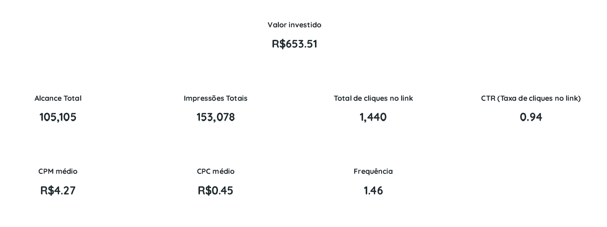
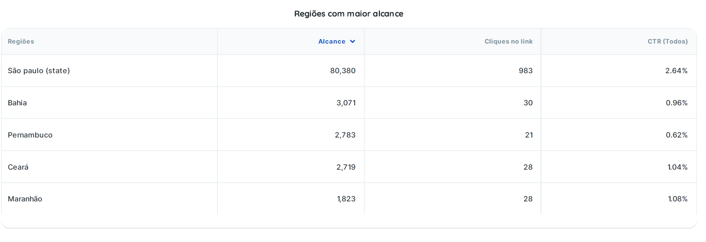
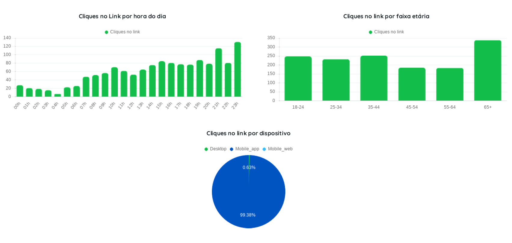
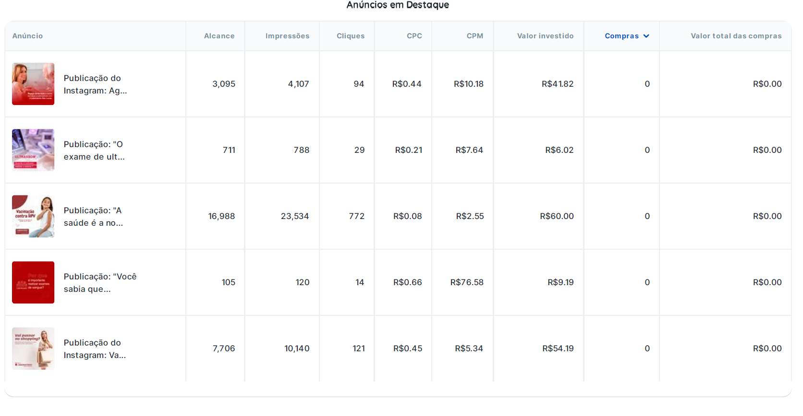

# 📊 Análise de Meta Ads e Google Ads | São Lucas e Seu Laboratório

**Foco:** leitura conjunta de distribuição, tráfego, custos e conversões registradas em campanhas de serviços laboratoriais.

**Entrega:** comparação dos indicadores disponíveis e recomendações para segmentação, criativos, campanhas e validação da mensuração.

## Contexto e objetivo

O trabalho reuniu relatórios de Meta Ads e Google Ads para analisar diferentes aspectos da aquisição e orientar oportunidades de investigação e testes.

A leitura conjunta permite observar o desempenho registrado em cada plataforma. Os materiais apresentados não conciliam a jornada de uma mesma pessoa entre os canais até o resultado comercial.

As capturas representam recortes históricos. Períodos, filtros e definições devem ser confirmados na fonte antes de comparações ou consolidações entre plataformas.

## Meta Ads: distribuição e tráfego

| Indicador | Valor exibido no relatório |
| --- | ---: |
| Investimento | R$ 653,51 |
| Alcance | 105.105 |
| Impressões | 153.078 |
| Cliques no link | 1.440 |
| CTR de cliques no link | 0,94% |
| CPC médio | R$ 0,45 |
| Frequência | 1,46 |
| CPM médio | R$ 4,27 |

*Figura 1 — Indicadores de distribuição e tráfego do Meta Ads no recorte apresentado.*

Os resultados descrevem a entrega e as interações registradas. A avaliação do CTR de 0,94% depende de objetivo, posicionamento, público, formato e histórico comparável; ele não é classificado como abaixo de um padrão universal.

O alcance não comprova reconhecimento de marca medido, e o custo por clique não informa, isoladamente, qualidade dos contatos ou resultado comercial.

## Google Ads: demanda de pesquisa e conversões registradas

| Indicador | Valor exibido no relatório |
| --- | ---: |
| Investimento | R$ 1.533,04 |
| Impressões | 31.370 |
| Cliques | 4.712 |
| CTR | 15,02% |
| CPC médio | R$ 0,33 |
| Conversões registradas | 1.490,52 |
| Taxa de conversão | 31,63% |
| Custo por conversão registrada | R$ 1,03 |
| Valor das conversões | R$ 6.479,19 |
| Relação valor das conversões / custo | 4,23 |

*Figura 2 — Consolidado do Google Ads, com contagem fracionada de conversões e valor atribuído às conversões.*

A contagem de 1.490,52 foi mantida como aparece na captura. Não deve ser interpretada como quantidade de pessoas únicas, reservas confirmadas ou exames realizados sem verificar as ações de conversão e conciliar os registros com a operação comercial.

O quadro informa **Valor das conversões** de R$ 6.479,19. A razão entre esse valor e o investimento é aproximadamente 4,23, rotulada como ROAS no material original. A confirmação de receita recebida depende de verificar como os valores foram definidos e sua correspondência com vendas. A captura não demonstra lucro ou manutenção da rentabilidade após ampliação do investimento.

## Leitura conjunta dos canais

A análise permite formular hipóteses sobre papéis complementares: Meta Ads pode apoiar distribuição e descoberta, enquanto campanhas de pesquisa podem atender demandas expressas nas consultas.

Neste case, essas possibilidades orientam a investigação. Os relatórios não comprovam que uma exposição no Meta causou uma conversão posterior no Google, nem apresentam atribuição integrada até a venda.

Também não é adequado usar a diferença entre os CTRs de 0,94% e 15,02% como prova de superioridade de um canal: objetivos, formatos, contextos de exibição e definições das métricas precisam ser considerados.

## Recomendações

- Confirmar períodos e filtros dos relatórios de cada plataforma.
- Documentar quais ações entram nas conversões e como os valores são atribuídos.
- Relacionar os contatos e agendamentos aos registros comerciais, quando disponíveis.
- Comparar criativos dentro de objetivos e públicos equivalentes.
- Investigar localização, horários e dispositivos com métricas de qualidade, além de volume.
- Separar consultas de marca, termos genéricos e serviços no Google Ads.
- Planejar testes com hipóteses, métricas e critérios de avaliação definidos.
- Avaliar alterações de orçamento após validar a qualidade das conversões e a capacidade operacional.

## Evidências complementares

### Distribuição geográfica no Meta Ads

*Figura 3 — Distribuição geográfica para investigação da aderência à área atendida.*

### Cliques no link por horário

*Figura 4 — Recorte de horários, que deve ser analisado em conjunto com investimento e qualidade dos contatos.*

### Criativos do Meta Ads

*Figura 5 — Criativos como insumo para hipóteses de teste; o recorte não isola o efeito do texto ou da imagem.*

### Evolução dos indicadores no Google Ads

*Figura 6 — Evolução dos indicadores de tráfego e custo do recorte disponível.*

### Campanhas e grupos de anúncios

*Figura 7 — Comparação por campanha, com atenção ao mix de intenção e às ações de conversão consideradas.*

*Figura 8 — Recorte por grupo de anúncios para orientar investigação da estrutura.*

### Palavras-chave e dispositivos

*Figura 9 — Palavras-chave como apoio à análise de consultas, marca e serviços.*

*Figura 10 — Distribuição por dispositivo para orientar a análise da experiência de navegação.*

## O que o case demonstra

- Leitura de indicadores de plataformas com objetivos e contextos distintos.
- Organização de hipóteses e recomendações para mídia paga.
- Atenção às definições de conversão e valor.
- Distinção entre resultados de mídia e resultados comerciais confirmados.

## Limites e próximos passos

A validação deve incluir período, configuração das conversões, origem dos valores e conciliação com os registros comerciais. Não foram demonstrados efeitos posteriores das recomendações sobre receita, qualidade dos contatos ou rentabilidade.

O material apoia o planejamento de análises e testes. Uma avaliação integrada do funil exige dados adicionais de jornada, contatos, agendamentos e vendas.

## Referências de mensuração

- [Google Ads — interpretação dos dados de conversão](https://support.google.com/google-ads/answer/6270625?hl=pt-BR).
- [Google Ads — valores de conversão](https://support.google.com/google-ads/answer/13064207?hl=pt-BR).

[Ver aprofundamento de Google Ads](../google-ads-performance/README.md) · [Voltar ao portfólio](../README.md)
