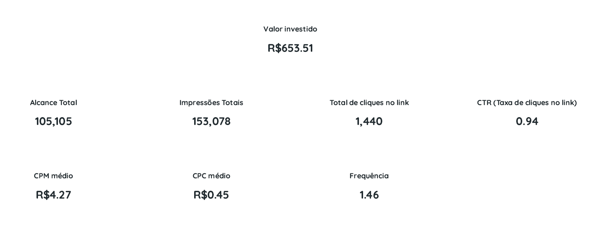
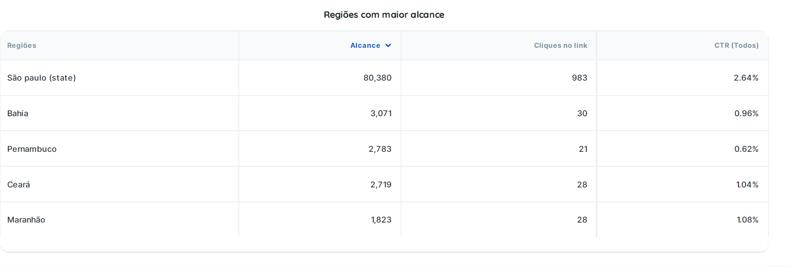
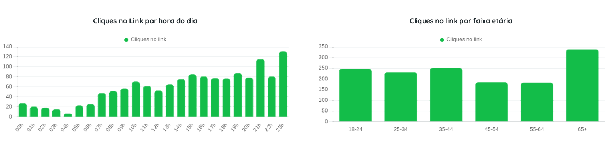
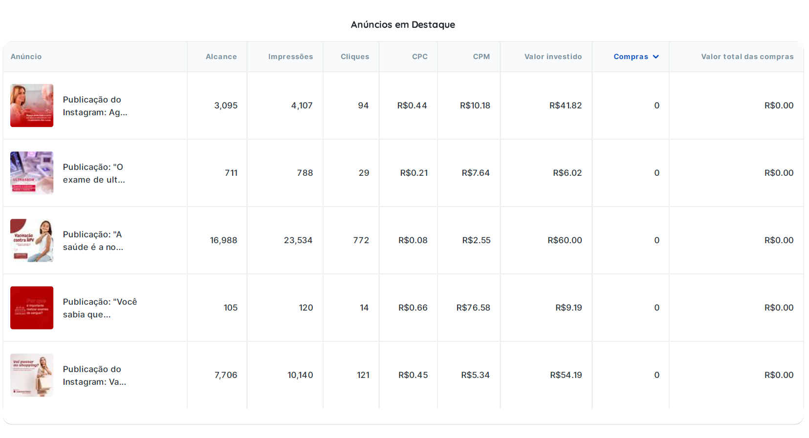

### Análise de Meta Ads e Google Ads | São Lucas e Seu Laboratório

**Foco:** alcance, frequência, cliques no link e custos das campanhas de Meta Ads.

**Entrega:** leitura dos relatórios disponíveis e recomendações de investigação de públicos, criativos e distribuição.

## Contexto e objetivo

O case apresenta uma análise de campanhas de serviços laboratoriais com objetivo de distribuição e geração de interesse. O material reúne indicadores de entrega e tráfego; a avaliação de contatos e resultados comerciais exige dados complementares.

As capturas representam um recorte histórico. O período completo e os filtros devem ser confirmados na fonte antes de comparações com outras campanhas.

## Indicadores apresentados

| Indicador | Valor exibido no relatório |
| --- | ---: |
| Investimento | R$ 653,51 |
| Alcance | 105.105 |
| Impressões | 153.078 |
| Cliques no link | 1.440 |
| CTR de cliques no link | 0,94% |
| CPC médio | R$ 0,45 |
| Frequência | 1,46 |
| CPM médio | R$ 4,27 |

*Figura 1 — Consolidado de alcance, impressões, cliques no link e custos do Meta Ads.*

## Leitura dos dados

O relatório registra 153.078 impressões, alcance de 105.105 e 1.440 cliques no link no recorte disponível. Esses valores descrevem a distribuição e a resposta registrada nos anúncios.

A frequência de 1,46 é compatível com a razão entre impressões e alcance. O CTR de 0,94% é compatível com a razão entre cliques no link e impressões. A análise de adequação desses indicadores depende do objetivo, público, posicionamento, formato e histórico comparável.

O alcance não equivale a reconhecimento de marca medido, e os cliques no link não representam automaticamente visitas concluídas, contatos ou vendas. O CPC e o CPM ajudam a analisar o custo da distribuição, mas a qualidade das interações deve ser investigada na jornada seguinte.

## Distribuição geográfica

*Figura 2 — Recorte geográfico para comparação com as regiões atendidas pela operação.*

A análise geográfica deve relacionar a entrega à área efetivamente atendida. Volume de alcance por região, isoladamente, não determina a qualidade dos contatos nem justifica expansão de cobertura.

## Cliques por horário

*Figura 3 — Recorte de horários para orientar hipóteses de análise da distribuição.*

Diferenças de volume entre horários precisam ser avaliadas em conjunto com investimento, disponibilidade de atendimento e resultados posteriores ao clique.

## Criativos e campanhas

*Figura 4 — Recorte de anúncios para investigação de mensagens, formatos e chamadas para ação.*

*Figura 5 — Organização dos resultados por campanha no recorte disponível.*

Os criativos podem orientar hipóteses para testes, como mensagem, benefício e CTA. A comparação deve considerar públicos, objetivos, orçamento e distribuição equivalentes; os relatórios não isolam o efeito de um elemento criativo.

## Recomendações

- Confirmar período, filtros, objetivos e definições das métricas.
- Comparar criativos em condições equivalentes e formular testes com hipótese e critério de avaliação.
- Relacionar os cliques às visitas efetivas e às ações relevantes na página de destino.
- Investigar localização e horários em conjunto com a qualidade dos contatos.
- Avaliar a experiência mobile, incluindo carregamento, leitura e acesso ao próximo passo.
- Utilizar histórico comparável e resultados posteriores ao clique para orientar alterações de distribuição e investimento.

## O que o case demonstra

- Leitura de indicadores de distribuição e tráfego.
- Organização de recortes de campanha para investigação.
- Formulação de hipóteses e recomendações de teste.
- Distinção entre interações de mídia e resultados comerciais.

## Limites e próximos passos

O material não concilia os cliques com contatos ou vendas e não demonstra ganho posterior às recomendações. O próximo passo é relacionar a entrega aos dados de navegação e aos registros comerciais disponíveis.

Os indicadores não são usados, isoladamente, para afirmar escala garantida, reconhecimento de marca ou superioridade de um formato criativo.

[Ver análise conjunta de Meta Ads e Google Ads](../sao-lucas-estrategia/README.md) · [Voltar ao portfólio](../README.md)
